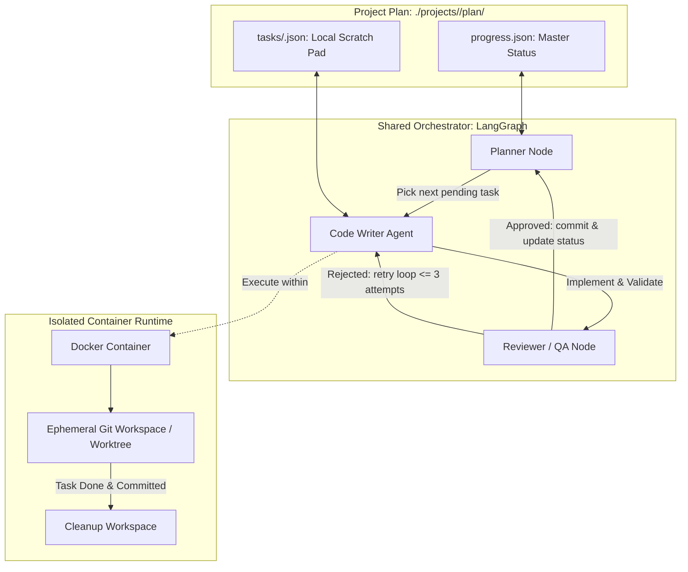

# Agentic

An agentic orchestration wrapper for **multi-agent, multi-project workflows**.

This repository manages automated software engineering across multiple sub-projects (`./projects/*`). An orchestrator drives execution 100% serially through a bespoke JSON-based plan and task graph, delegating individual tasks to specialized AI agents executing within isolated Docker containers and ephemeral Git workspaces.

---

## 🏗️ System Architecture



### Key Components

1. **Top-Level Orchestrator (`.shared_orchestrator/`)**:
   - Built on [LangGraph](https://github.com/langchain-ai/langgraph) (see [`.shared_orchestrator/graph.py`](file:///home/pdavis/dev/agentic/.shared_orchestrator/graph.py)).
   - Coordinates the lifecycle: task selection, workspace provisioning, worker assignment, testing/review, and status reconciliation.
   - Role prompts and operational specifications live in [`.shared_orchestrator/roles/`](file:///home/pdavis/dev/agentic/.shared_orchestrator/roles/).

2. **Project Repositories (`projects/*`)**:
   - Each subfolder under `projects/` represents an independent project (e.g., [`projects/parade`](file:///home/pdavis/dev/agentic/projects/parade), [`projects/android_sensor`](file:///home/pdavis/dev/agentic/projects/android_sensor), [`projects/options`](file:///home/pdavis/dev/agentic/projects/options)).
   - Projects maintain their own tech stack, tests, dependencies, and configuration.

3. **Plan -> Tasks Data Structure (`projects/<project>/plan/`)**:
   - **`progress.json`**: Master roadmap and status ledger for the project. Tasks are ordered and tracked here.
   - **`tasks/<id>.json`**: Granular, per-task specification and scratchpad owned by the active worker agent.
   - **`AGENTS.md`**: Project-specific rules and instructions for participating agents.

4. **Containerized Execution & Ephemeral Git Workspaces**:
   - **Docker Isolation**: All code modifications and builds run in isolated containers defined under [`docker/`](file:///home/pdavis/dev/agentic/docker).
   - **Ephemeral Git Workspaces**: Each task runs in a dedicated, temporary Git branch or worktree.
   - **Lifecycle**:
     1. Orchestrator reads next `pending` task from `progress.json`.
     2. Spins up an ephemeral Git workspace and mounting container.
     3. Worker agent implements code and executes local validation tests.
     4. Reviewer verifies criteria and diff.
     5. On approval: atomic commit created, workspace cleaned up, and status updated to `done`.

---

## 📋 Plan & Task Schema

Each project's `plan/progress.json` defines tasks with the following JSON schema:

```json
{
  "id": "unique-kebab-case-id",
  "title": "Concise task title",
  "phase": "step-1-foundation",
  "status": "pending",
  "requirements": [
    "Explicit, verifiable acceptance criteria."
  ],
  "context": [
    "src/components/Target.tsx"
  ],
  "depends_on": ["previous-task-id"],
  "notes": "Worker scratch space (persisted in tasks/<id>.json)"
}
```

### Allowed Status Values
- `pending`: Not started.
- `in_progress`: Currently assigned to an active container / worker agent.
- `blocked`: Waiting on an unmet dependency or human clarification.
- `review`: Implementation complete, pending automated/peer review.
- `done`: Verified, committed, and merged into project baseline.

### Access & Mutation Rules
- **Single Source of Truth**: Master task states live in `progress.json`.
- **Worker Concurrency & Boundary**: Worker agents may **ONLY** modify the `status` field in `progress.json` (using atomic `jq`). All scratch notes, intermediate output, and implementation logs belong in `tasks/<id>.json`.
- **Serial Execution**: Tasks are processed strictly top-to-bottom respecting `depends_on` constraints.

---

## 🚀 Setup & Usage

### Prerequisites
- Python >= 3.12
- [PDM](https://pdm-project.org/)
- Docker engine & CLI
- `jq` (available in PATH)

### Install Dependencies

```bash
pdm install
```

### Validate Orchestrator

```bash
pdm run python -c "import sys; sys.path.insert(0, '.shared_orchestrator'); import graph; print(graph.app)"
```

### Running Tasks

When executing tasks on a project:
1. Target the project directory: `projects/<project-name>`.
2. Inspect `plan/progress.json` for the next available task.
3. Spawn a clean git worktree / docker environment for the worker.
4. Update task status: `pending` -> `in_progress` -> `review` -> `done`.

